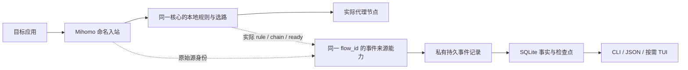

# ADR 005：由同一数据面产生身份、计量、计时和线路事实

日期：2026-10-22。状态：重规划方案已确定；原型部分完成，完整事件源待实现和验收。用户要求修复三个缺口或重新规划，本 ADR 调整技术路线，不降低进程/域名完整性要求，不豁免 P0，不自动授权核心 fork、特权或系统改动。

本 ADR 替代 [ADR 001](001-event-source.md) 中“替代路线尚未确定”的状态及各设计文档中“完整计量必经 GOST”的技术假设；保留原候选失败的历史事实。[ADR 002](002-p0-core-gates.md) 的不放行结论仍成立。

## 1. 问题重新归因

三个缺口有共同原因：原方案把源身份、累计 bytes、终末事件和实际节点分别交给不同的组件，再尝试事后拼接。端口/时间接近并不能证明它们属于同一条连接。

另一个需要纠正的前提是“必须由 GOST 原生提供持久序号”。产品要求是已确认事件不重计、可恢复与不可恢复分别说明；序号和持久化可以由 Hoopa 的接收 journal 提供。它只证明已经收到的事件，不能补出 GOST 没有发送的终末记录，`receipt_seq` 不能冒充 `source_seq`。发生明确 gap 不等于承诺无损失败；正常受控支持场景仍须完整采集。

## 2. 路线选择

| 路线 | 身份与线路 | 恢复与计时 | 决定 |
| --- | --- | --- | --- |
| GOST metrics + Mihomo 活动快照 | 转发后源变成 GOST，短流和跨跳关联不完整 | 没有可信终末重放或 setup 起止 | 不作为完整统计事实源 |
| GOST admission + 独立 `/proc` 解析 + recorder | 能提前取得 tuple，但还需 SID 映射、权限/共享 FD 证明；route 仍不等于 Mihomo 实际链 | 接收 journal 能保存已送达事件，无法修复源端漏投 | 只保留限定实验，停止向该组合叠加生产 adapter |
| 应用直接进入 Mihomo，由同一数据面产出完整事件 | 原始 socket、规则决策、流量 tracker 与实际 chain 在同一上下文中关联 | 补充生命周期/计时及源端持久化契约 | 选为下一原型路线；stock 版本尚不具备全部能力 |
| 自研 HTTP/SOCKS 内核、默认 eBPF/TUN/抓包 | 范围与权限显著扩大 | 新的协议和平台维护负担 | 不采用 |

新目标拓扑：

图中完整事件来源能力与生产链路尚未实现。基础接入直接使用 stock Mihomo，不装配 journal/SQLite；完整计量只在验证了事件来源能力后开启。GOST 留作可选兼容入口、累计对照和实验工具，不再是完整统计的必经跳。

## 3. 固定上游的实际边界

检查 [Mihomo v1.19.26 metadata](https://github.com/MetaCubeX/mihomo/blob/v1.19.26/constant/metadata.go)：公开元数据有 process/path/uid 和源 tuple，没有足够的 PID/启动身份。直接移除 GOST 并不会自动补齐这些字段。

[tracker](https://github.com/MetaCubeX/mihomo/blob/v1.19.26/tunnel/statistic/tracker.go) 已在同一记录中维护连接计数、规则与实际 chain，但关闭时从[活动集合](https://github.com/MetaCubeX/mihomo/blob/v1.19.26/tunnel/statistic/manager.go)移除；现有 API 不是完整终末日志。[TCP 转发流程](https://github.com/MetaCubeX/mihomo/blob/v1.19.26/tunnel/tunnel.go)给出了选路、拨号、延迟握手与 tracker 的候选观测位置，不表示这些观测点已经输出事件。

本地 GOST 报告版本 3.3.1，但 build info 指向主模块 revision `ece7770ad78f86744aa95c7887ead065642f96b4`、x v0.17.2、core v0.6.1。匹配依赖源码可用于核对接口，不能据版本字符串推断同名官方发布资产。后续 manifest 补记 build info，来源验证仍为 false。

GOST [admission](https://github.com/go-gost/x/blob/v0.17.2/admission/wrapper/listener.go)是转发前的同步入口，HTTP 请求有 service/network/来源 addr，无本地 entry tuple 或 PID；须用可信 service 配置映射监听地址。开启 PROXY header 时声明地址不一定是当前内核 socket tuple。此接口事实已查，现有身份探针未与其接线。

## 4. 原进程身份与规则

完整来源应在原始应用 socket 处、路由前生成 `ProcessEvidence`，至少含 boot、PID namespace、PID、OS start、名称与名称来源、socket identity、观测时点和可信范围。实例 ID 与主/子进程分开；名字、可执行路径、profile 与 launch 不相互代替。

独立 Linux `/proc` 探针已实现：同 UID/同 netns/IPv4 loopback，检查 tuple/inode 与进程 FD，发现多持有者拒绝；无法读取完整 owner 集合也拒绝。共享 FD 子断言通过；100 原入口连接在本宿主因进程 FD 权限不足而未验证，不计入 G01 成功。跨 UID FD 共享、FD 转移竞态、IPv6/其他平台均没有由此解决，不能改为静默忽略权限错误。

因此下一原型优先把已有核心进程查询的结果扩充为有身份世代及覆盖说明的证据，并与选路事件同源输出。缺身份时按已有三值语义拒绝相关进程规则；不需要进程条件的基础规则仍独立执行。管理器/SQLite 不参与每连接决策；不能通过每连接调用管理器来补齐身份。

## 5. 接收可靠性与源端缺口分开

已实现的[实验 journal](../../experiments/telemetry/README.md)规则：

- `(source_epoch,event_id)` 标识事件；完整 frame Write + Sync 后才确认。接收序号是本 journal 的 `receipt_seq`。
- 同键同原文重试返回原序号，不再记账；同键异原文拒绝。整数原文不经 float64。
- 写入或 Sync 结果不确定后停止接纳，重开扫描并再次 Sync 后按原 ID 消歧；坏帧/半帧拒绝，不自动丢尾。
- 接收 journal 重开恢复不等于源端 replay，更不等于 SQLite checkpoint/delta/gap 事务已经实现。

完整来源还须先持久记录一次连接存在，再准许计量连接开始；有 start 而无可信 final 的连接保留 pending/unknown gap。正常关闭的终末计数与来源事件身份在产生方保存，管理器停机可再消费。周期 checkpoint 只缩小故障损失窗口；核心崩溃后的未确认尾部不能假装精确恢复。

生产 journal 要有磁盘/段大小上限、消费确认、保留与回放协议；本轮内存索引实验不代表容量达标。源端满盘/积压时拒绝新的完整计量连接，已有转发不静默改路；旧连接不能持久记录的区间明确为 gap。协议须能区分“已写但 ACK 丢失”“根本未送达”“源端永久丢失”，不能统一显示零。

## 6. 一个连接身份贯穿事件

下列为拟议事件契约，当前 stock API 不提供：

| 事件 | 关键内容与产生位置 |
| --- | --- |
| FlowOpened | 原始 socket、可信进程证据、可观察目标、入站/profile、配置世代；在同一数据面生成 flow_id |
| RouteDecided | 原 flow_id、规则、已解析稳定目标及当时身份结果；路由前生成，unknown 拒绝单列 |
| SetupFinished | flow_id/attempt_id、定义版本、单调耗时、success/failure/timeout/cancelled、failure_stage |
| BytesCheckpoint / FlowClosed | 同一 flow_id、准确整数双向累计、boundary_ref、source epoch/seq、是否 final；不把终末累计再加到区间增量 |
| RouteEvidence | 同一 flow_id/attempt、实际 ordered chain/provider、原配置内稳定节点映射；当前 now 单独查询 |
| SourceGap / EpochClosed | 最后可信位置、缺失范围/维度、原因及完整性；无法得知丢失字节时为 null |

`flow_id` 在成功拨号前分配，失败也能关联；`attempt_id` 区分重试，不能只记录成功建立的 tracker。setup 起点是完整代理请求已解析、目标已知，终点是可实际转发通道 ready；DNS 在范围内。延迟握手必须核对真实完成点，不能简单使用 Dial 返回或 tracker.Start。HTTPS 正文与连接复用中的业务 TTFB 保持 N/A；不做业务解密。

完整计量候选采用 `mihomo_proxy_stream_v1` 边界：原应用入口关联的已验收代理转发流字节，不自动包括 HTTP/SOCKS 认证握手、内核 IP/TCP 包头或公网 TLS 封装开销。实际 read/write、缓冲预读及失败写入口径须由原型冻结，未验证前该边界不可启用。旧 GOST 入口原始字节使用独立 boundary/source 标识，不覆盖历史、不并入新累计、不硬凑相等。

## 7. 上游改动范围与选择关口

首选核实上游可提供或愿意接受的可观测性接口。若需增强，限定在进程证据查询、`constant/metadata.go`、`tunnel/tunnel.go`、`tunnel/statistic` 的证据/生命周期钩子，以及有界持久事件输出；不重写代理协议、DNS 引擎、节点协议或路由器。先给出固定源码的可审查改动与许可影响，再决定是否构建独立的实验核心；重规划时未构建fork，后续隔离实现见第10节，未发行核心。

接受上游增强、维护一个小补丁或调整产品范围是后续明确关口，不能在缺少决定时假装 stock 核心支持。临时 patched core 与 stock core 必须是不同能力记录、路径和 SHA，Rotom 不被要求自动替换用户核心。Hoopa 继续是外部核心管理器，不嵌入 Mihomo 库。

## 8. 后续执行与验收

1. T122–T124：验证接收 journal、原入口身份探针和真实 recorder 落盘重开。只关闭各自子断言，不放行整体门槛。
2. T125–T126：定稿本 ADR/契约/能力矩阵，准备可审查的上游观测点改动；验证未支持能力被拒绝，没有伪造字段。
3. T127–T129：以同一来源重跑 G01/G02/G03/G05，覆盖 100 真短流、共享/权限/PID 复用、ACK 丢失与未投递、核心/采集器退出、慢 DNS/建链、失败和两线路历史。
4. 完成后再评审 T017/T018。完整计量不通过就继续保留阻断；不通过删掉 PID/域名/质量要求来宣布完成。

后续基础管理、SQL 驱动与 TUI 的原依赖不在本 ADR 中绕开；宪章、规格成功标准和旧证据保持可追溯。

## 9. T126 准备进展（2026-10-22）

固定 `v1.19.26` 标签解析为 `fc8c5a24b16991f98cd736950c17d1aa306a5041`，16份已审查文件（含LICENSE/go.mod）摘要已记录；
现有二进制revision相同但`vcs.modified=true`，不能证明等同干净标签源码。进程首个owner、unknown规则后备、listener直接proxy绕过、
buffer/peek计数及延迟握手边界已逐点核对，见[源码审查](../../experiments/mihomo-events/source-review.md)。

[具体增强提案](../../experiments/mihomo-events/upstream-proposal.md)列出身份/三值规则/同flow计时与实际链/有界源日志的改动范围和恢复顺序。
Hoopa内新增的计数帧codec已通过定向测试，只解码原生counter事件，不构成Mihomo增强或来源验收。
此准备阶段当时尚无可应用核心补丁或可运行候选，也未实施/构建/发行fork；T126、T127–T129及T018的完成条件不变。

## 10. 隔离候选与身份断言（2026-10-22）

用户在具体提案及隔离实验授权问题后再次调用implement，按提案在私有/tmp实施、构建并运行受控loopback，未覆盖用户核心或启用特权。
实际16文件补丁与独立candidate hash/version记录在[manifest](../../experiments/mihomo-events/candidate-manifest.json)；
来源保留原socket证据、独立source_seq/源日志、flow/attempt/实际chain、同步终末与维度gap，不把接收序号当源序号。

定向23项race、vet和构建通过，单流传输及source身份清单绑定子断言通过，T126取得可运行候选。
随后100预登记短流的终末字节/域名100%正确，但源PID/名称/start正确0/100，均owner_visibility；真实G01断言exit1。
全部样本保留，T127未完成，T128/T129未启动，T018不放行；完整恢复/协议ready/实际两线路及配置加载期能力拒绝仍未通过。
详见[失败记录](../validation/native-candidate.md)。不能忽略不可见owner、默认提权或更改100%真值要求来关闭门槛。

## 11. 失败后的执行前提修订（2026-10-23）

第8节为原整改序列，后续以新[plan/tasks](../../specs/001-hoopa-proxy-manager/plan.md)为准：T130–T132先证明同拓扑环境前提及具体原socket身份算法，T133–T135明确补全来源生命周期、协议ready/实际链及配置加载期拒绝/入口保护，T137冻结新候选后才重新执行正式T127–T129。T136提供控制/应用/恢复最小harness，T138补齐生产来源与接收日志的有界确认/回收；都不是已实现能力。

旧0/100和全部原始分母保持；仅当与失败直接相关的环境、方案或实现输入发生可观察变化且有明确因果预期时才重试，文档修改或仅重编相同源码不构成理由。当前普通权限前提不满足不等同证明算法本身有bug，也不能用“换环境”代替具体证据条件；若方案无法证明完整owner及路由时点身份，继续保留架构阻断。T138后续生成新核心/协议时由该任务承担重新冻结及受影响能力复验，T072/T077只接受与当前制品匹配的能力记录。修订依据及其他阶段修复见[全范围复核](../validation/plan-task-review.md)。

2026-10-23后续可行性复核及用户澄清见[ADR007](007-p0-evidence-closure.md)：默认源进程按原始TCP连接发起实例及建连名称/路径快照；FD转交/共享不改已证connector。本文旧owner诊断保留历史事实，不再要求以完整当前FD owner集合定义新归属；旧0/100、同源事件路线及新制品复验约束不变。
