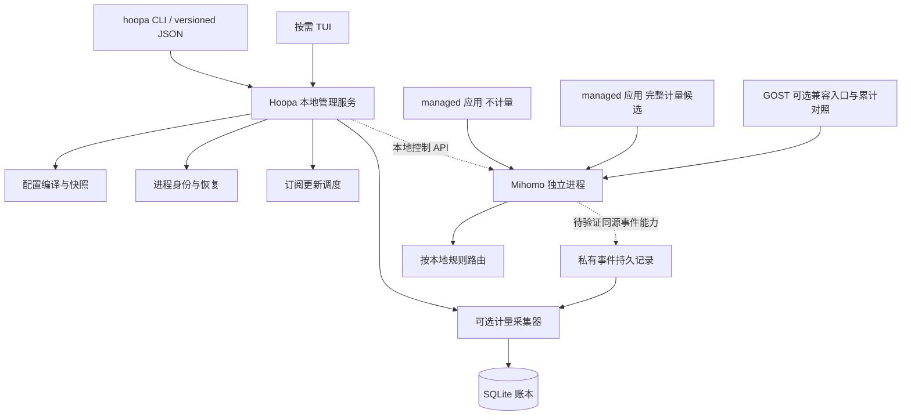

# Hoopa 架构与结构设计

状态：P0实测后重规划，更新日期：2026-10-22。完整统计路线按[ADR 005](adr/005-telemetry-replan.md)改为同一数据面事件；原组合有校准证据，完整计量与生产CLI尚未验收。

Hoopa 是独立、命令行优先的代理管理器，展示说明为 **CLI-first Proxy Manager**，命令为 `hoopa`。面向 Linux SSH、日常终端和 Agent 工作流。仓库后缀尚未确定，因此本设计不预设远程仓库名或 Go module 地址。

面向用户的八个功能模块、四项优先补足的使用流程和阶段归属见[功能规划](features.md)，应用与进程选择节点/group 的规则见[路由设计](routing.md)。本文说明这些功能背后的实现边界；功能模块不要求与 Go 包一一对应。

## 1. 范围与决策等级

本文的“约束”来自已确认的产品要求；“首期方案”是建议实现的基线；“原型门槛”表示必须取得运行证据后才能承诺。配置片段和命令均为拟议接口，当前仓库尚未实现。

| 等级 | 内容 |
| --- | --- |
| 约束 | Go + Cobra；按需 Bubble Tea / Bubbles；独立 Mihomo；可选 GOST；SQLite 用于历史账本，驱动待验证 |
| 约束 | 基础管理不依赖 GOST、SQLite 或 TUI；关闭界面不代表停止转发 |
| 约束 | 多个订阅只供节点；规则、稳定逻辑组和跟随关系由本地管理 |
| 首期方案 | 单仓库、单 Go module，构建生成一个 `hoopa` 命令行程序；管理服务和 TUI 使用该程序的不同运行入口 |
| 首期方案 | 订阅由 Hoopa 更新成不可变文件快照；Mihomo 读取本地 provider，不再独立拉取同一订阅 |
| 首期方案 | 计量开关只影响后续启动；跨供应商及多组拓扑切换采用可恢复的完整配置替换，默认允许明确披露的连接中断 |
| 原型门槛 | 脱离 SSH 会话、管理器崩溃后的存活与接管；GOST 字节语义；配置重载和长连接行为 |

不自研代理内核；不默认启用 TUN、系统代理、自启动或系统计划任务。不建设 Web 管理平台、云同步、远程控制或插件市场。Rotom 负责固定版本安装；Hoopa 只消费明确的二进制位置和版本，不接管 Rotom 的内部状态。

## 2. 运行结构与依赖



管理面与转发路径分离。代理数据不经过 Hoopa Go 进程。Mihomo 和 GOST 不通过管理器持有的 stdin/stdout 管道维持生命；日志写入独立、受大小限制的文件。管理器失联时已有转发应继续，自动更新和采集暂停；是否达标由 P0 测试决定。

完整计量候选让源PID/启动身份、flow/attempt、计量、setup起止和实际链在同一Mihomo数据面生成，再持久消费；stock当前API尚不具备完整事件能力。GOST metrics只保留累计对照，不与新流边界混算。接收journal可保存已送达事件，无法恢复的源尾部明确gap。P2同名/域名/交叉视图共用事实，详见[统计设计](traffic-statistics.md)及[ADR 005](adr/005-telemetry-replan.md)；图不是已实现能力声明。

`hoopa start` 显式启动用户态管理服务和 Mihomo；不安装系统服务。`hoopa service run` 是前台运行入口，便于开发或由用户已有的服务管理器托管。`hoopa tui` 只是连接服务的客户端，退出只关闭界面。服务不存在时，查询命令返回 `stopped`，不顺手启动。

`hoopa stop` 明确停止本实例拥有的转发进程，可能打断应用连接；管理器单独退出与停止整套代理是两种操作。具体命令命名可在 P0 后调整，但必须在帮助中披露作用。进程崩溃后的自动重启仅在管理服务仍运行时按有限退避执行，不承诺主机重启或用户退出后自动恢复。

Linux 为首个实现平台。脱离会话不等于能跨越系统的用户会话清理策略；SSH 退出、用户注销、管理器被杀和主机重启分别验收。macOS 的进程会话与 Windows 的进程句柄 / Job Object 行为封装在平台层，未经实测不标注正式支持。

## 3. 仓库组织

以下是随阶段逐步建立的目标结构，不提前创建空包或通用框架。

Git 保存源码、文档、配置模板、测试数据和构建定义。Hoopa 编译产物、发行压缩包、Mihomo/GOST 可执行文件以及运行数据不提交到源码仓库；实现构建流程时加入对应忽略规则。

```text
cmd/hoopa/main.go                 组装依赖、退出码、版本信息
internal/
  cli/                           Cobra 参数、展示、JSON 输出
  control/                       本地服务、用例、写操作串行化、操作恢复
  config/                        用户意图、严格解析、迁移、原子文件操作
  subscription/                  获取、限流、校验、节点归一化、快照
  policy/                        逻辑组、跟随图、应用/进程规则、地区匹配与编译
  runtime/                       进程生命周期、身份校验、端口与运行记录
  mihomo/                        配置生成、版本能力检查、controller 客户端
  launch/                        应用模式、环境构造、信号与退出状态
  schedule/                      单次补跑、退避、时钟处理
  metering/                      可选计量、连接/质量事实、源身份/目标归属、世代与差量
  ledger/                        SQLite 迁移、事务、进程/域名查询、对账与缺口
  tui/                           Bubble Tea Model / Update / View
  platform/                      路径、锁、进程身份、本地 IPC 的 OS 实现
api/v1/                          JSON Schema、错误码、兼容性说明
experiments/gost-mihomo/          P0 配置模板、最小 harness、脱敏证据
testdata/                        合成订阅、指标文本、配置黄金文件
tests/integration/               核心进程和故障注入测试
docs/                           设计、原型、规范、决策与验收记录
.github/workflows/               后续标准托管 CI
```

依赖方向为 `cli/tui → control 用例 → policy/subscription/runtime 等能力`。`policy` 不导入 Cobra、Bubble Tea、GOST 或 SQL；核心进程通过适配器访问，不把 Mihomo 作为 Go 库嵌入。`ledger` 故障不阻止不计量的基本代理管理。`launch` 的 direct / inherit 路径无需启动管理服务。

包在真实边界形成后再拆分。接口放在消费方，仅对实际需要替换的时钟、进程、核心 API、订阅来源和账本写入定义小接口。不建立 `utils`、通用插件系统、事件总线或未使用的多内核抽象。

## 4. 配置、文件与持久状态

采用有版本号的 YAML 表达用户意图，严格拒绝未知字段；agentcfg 通过版本化 JSON 命令调用用例，不直接编辑 YAML、运行文件或数据库。

```yaml
schema_version: 1
subscriptions:
  - id: primary
    url_file: /private/path/primary.url
    update_hours: 6
selection:
  active_subscription: primary
groups:
  US: {region: US, strategy: manual, required: true}
  JP: {region: JP, strategy: auto, required: true}
  BEST: {strategy: auto, required: true}
apps:
  agent:
    mode: managed
    metering: false
```

此片段只解释意图层，不是可直接加载的 Mihomo 配置。规则、节点覆盖映射、手选节点和跟随关系拥有明确字段及 schema；正式 schema 在 P1 编写，不能把本例当作已有协议。订阅 URL 文件是首期秘密输入方式，不要求用户将凭据放入命令行参数。

| 数据 | Linux 默认位置候选 | 写入者与规则 |
| --- | --- | --- |
| 用户配置 | `$XDG_CONFIG_HOME/hoopa/`，未设置时 `~/.config/hoopa/` | 显式配置命令；包含 schema 与意图 revision |
| 可恢复状态、快照、日志 | `$XDG_STATE_HOME/hoopa/`，未设置时 `~/.local/state/hoopa/` | 管理服务；快照私有且不可变 |
| 可丢弃下载暂存 | `$XDG_CACHE_HOME/hoopa/`，未设置时 `~/.cache/hoopa/` | 下载器；删除不应破坏当前可用快照 |
| socket、临时句柄 | `$XDG_RUNTIME_DIR/hoopa/`，未设置时 `state/runtime` | 用户私有；持久写锁另放 `state/.writer.lock`，不能直接共用公开 `/tmp/hoopa`；具体边界见 [ADR012](adr/012-p1-file-store.md) |
| `ledger.sqlite` | 状态目录 | 计量采集单写入者；基础代理不需要该文件 |

状态目录中保留 `snapshots/<generation>/manifest.json`、节点 provider 文件、生成的 Mihomo 配置、规则资产和必要的选择种子。manifest 包含 schema、源快照摘要、编译器版本、核心版本能力、文件哈希和创建时间。运行状态另外记录进程身份与实际观测，不把“文件已生成”当作“已生效”。

权威关系是：用户意图决定目标，`active.json` 指向最后一次确认生效的完整快照，操作记录描述尚未完成的变更，实际进程状态决定是否漂移。`active.json` 与未完成操作记录必须位于持久状态目录，不能只放在重启会清空的 runtime 目录。删除快照前检查 active、回滚、未完成操作以及仍存活进程引用。

私有目录与文件使用限制权限，Windows 使用对应 ACL。订阅凭据、节点认证信息和 controller secret 不出现在日志、默认 JSON、诊断包或测试 fixtures；导出配置时明确标注敏感性。导入的远端数据只提取允许的节点字段，不能覆盖本地规则、监听地址、TUN、控制 API、脚本或文件路径。

## 5. 订阅、节点与稳定逻辑组

订阅标识、节点标识和显示名分离。节点在订阅命名空间中归一化，重复名称不覆盖；内部引用不依赖供应商的显示名唯一。地区优先使用本地显式映射，名称匹配规则次之，无法识别的节点标记 `unknown`；旗帜和字符串匹配不构成地理真实性保证。

首期订阅支持范围明确限制为经过 fixtures 验证的 Clash/Mihomo 节点 YAML；其他格式逐项增加，不引入在线订阅转换服务。下载限制超时、大小、节点数、解析深度和并发，校验 TLS，拒绝远端路径引用与危险 YAML 构造。HTTPS 为默认；私有源或本地文件通过显式来源类型配置。

稳定组 `US`、`JP`、`BEST` 对外不改名，内部成员来自当前选择的订阅。`BEST` 的“选优”首期指探测 URL 的延迟与健康状态，不宣称模型服务可用性、带宽或账单最优。自动组由 Mihomo 的已验证能力执行，探测频率和切换容差有上限；Hoopa 不再运行一套竞争的选优循环。经 `use` 引入的节点启用 provider 自身的 health check，不能假定组级探测会覆盖它们；BEST 确实能测到并选中这些候选是原型门槛。

跟随分为两类，避免含糊地维护多个独立选择器：

- **跟随订阅**：US、JP、BEST 等声明跟随 `active_subscription`，一次编译解析全部依赖。
- **跟随逻辑目标**：某业务别名跟随 US，生成对 US 的组引用，不复制当时 US 选择的具体节点。手选和自动选优因此自然传递。

编译前检查依赖图无环、所有引用存在、必需地区非空、组内手选节点仍属于该组解析的订阅、无跨供应商的隐式候选。规则中显式 provider + node ID 的固定节点不随活动订阅重绑定；完整候选包含并校验所有被引用来源的快照，这些 pin 不成为其他组的隐式后备。节点缺失时拒绝此次变更，保留旧快照并报告具体受影响组/规则。用户明确将某可选组定义为不可用时，编译成经过验证的拒绝策略，而非空组。单独配置的直连规则可以存在，但不可作为缺节点的后备路径。

每个生成组必须显式指定拒绝型 `empty-fallback`，首选固定版本支持的内置 `REJECT` proxy，不能指向另一个组；若该核心版本不支持此语义则拒绝应用，不能依赖默认 `COMPATIBLE`。Mihomo 的空组行为不能替 Hoopa 决定安全边界，相关证据见[上游资料](references.md)。编译器既做静态检查，也在启动后核对实际组成员、选中项和兜底策略；必需组为空仍然使候选验证失败。

## 6. 应用配置的提交与恢复

文件原子替换、核心配置重载、多个组的 API 调用和 SQLite 事务是不同边界。Hoopa 不承诺跨它们的原子事务。所有修改运行状态的操作由同一管理服务串行执行；文件锁防止第二个管理器成为写入者，意图 revision 防止旧客户端覆盖新配置。

每次变更有 `operation_id`、预期旧 revision、目标 generation、旧 generation 和阶段记录。网络下载与编译在短锁外进行，进入应用阶段重新核对 revision。运行与文件操作不在 SQLite 长事务内执行。

```text
prepare → validate → record applying → apply → verify runtime
                                              ├─ success → publish active → record committed
                                              └─ failure → rollback old → verify old → record rolled_back
                                                                          └─ failure → degraded
```

1. 下载和编译到新目录，固定全部 provider 与规则资产；不修改活动文件。调用固定版本核心的配置检查，验证监听端口和依赖完整性。
2. 持久记录操作意图后才触碰运行进程。文件持久化采用同目录临时文件、同步和平台支持的原子替换；Linux 还需处理目录持久化。不能用一次 rename 推导跨文件原子性。
3. **首期跨供应商或多组拓扑变更以受控停机替换为基线**：完整停止并确认旧 Mihomo 已退出，再从候选快照启动。启动阶段只开放私有 controller，关闭全部代理入站、TUN 和对外 DNS 监听；待本地 provider、全部组选择及应用入站规则验证后，才通过已验证的配置能力启用共享或应用专属入站。多个入站只从同一候选世代开放，部分绑定失败不得提交成功，需关闭候选并按完整旧快照恢复。该分阶段启动方案本身也是 P0 门槛，若固定版本做不到，就不能声称解决了严格切换一致性，需重新决策。禁止监听后再用多次 API 慢慢补齐组选择。选择缓存隔离到 generation，不能沿用旧供应商的缓存。自动组在仅控制端阶段完成首次探测，使用当前订阅内经过核验的候选，未准备好时保持入口关闭。
4. 核对 API、实际 PID 身份、监听、全部必需组、选中项与规则，再提交 `active.json`。停止窗口允许连接失败；任何新监听实例必须从完整的单一快照启动。操作返回中明确说明长连接会中断，不能把它描述成无缝切换。
5. 失败时先确认候选退出，再从完整旧快照恢复并验证。只有旧运行态确认恢复才能报 `rolled_back`；回滚再次失败则报 `degraded`，保留证据，停止自动写操作，不改成直连。
6. 管理器重启后先校验身份并读取未完成操作：若运行态与旧/新快照之一完全匹配，则补齐提交或回滚；若无法判定，阻止新写操作，要求显式恢复。只读查询仍可用。不能仅凭日志中最后一条 success 推断结果。

停机切换的开销需要 P0 量化。周期下载成功先形成候选；若应用它需要停机，默认保留为 `pending`，由显式 apply 或用户事先配置的中断策略处理，不能每小时暗中断线。只有单组选择、无拓扑变更且依赖关系已由组引用表达时，才考虑经过验证的单次核心选择调用。完整热重载必须先通过并发连接下的一致性和恢复测试，再由决策记录放宽基线。

上述流程的验收目标是配置世代的一致切换，不提供远端连接级事务。即使以后支持热切换，旧连接仍可能保留旧路径；“新连接一致”与“所有存量连接一起改路”必须分开报告。GOST 不因 Mihomo 配置变化而默认重启，已有上游连接能否保留由测试决定。

## 7. 更新调度与失败策略

更新周期以小时配置，首期取正整数小时。每个订阅只有一个更新在执行；手动与定时更新走同一管线。持久保存最后尝试、最后成功和下一次应检查时间，区分抓取成功与活动配置提交成功。

常驻管理服务运行期间负责调度；它退出时不偷偷安装 cron 或系统任务。启动或休眠恢复发现逾期时，每个到期订阅最多补一次，所有补跑受全局并发和错峰限制；完成后从当前时间计算下一周期，不重放错过的每个小时。正常计时使用单调时间，跨进程记录使用 UTC；墙钟跳变不能形成追赶风暴。

下载或验证失败使用有界退避和抖动，保留上一份可用快照。不能在更新失败时改用别家订阅、清空节点或自动调用核心升级 API。首次无快照时明确不可启动。失败来源、旧快照年龄和候选待应用状态在 status 中可见。

## 8. 进程身份与接管

单独保存 PID 不足以证明进程归属。运行记录至少包含实例 ID、角色、二进制路径与摘要、PID、OS 启动身份、核心/入口世代、配置摘要、监听地址和受保护的控制端身份。Linux 原型检查 boot ID 与 `/proc` 启动时间；其他平台采用其原生创建时间或句柄证明。

管理器重启先拿实例锁，再核对进程身份、二进制和端口拥有者，最后进行受保护的 API 探测。API 能返回版本号不能单独证明是本实例。无法可靠证明身份时只报告冲突，不杀进程、不覆盖端口、不直接另起重复核心。新的管理器运行 ID 不等于新的 GOST 计数世代。

子进程需要正确回收；脱离会话的核心不绑定管理器 context 的取消而被自动 kill。启动中间状态也记录身份，避免“spawn 后、写 PID 前崩溃”留下无法识别的进程；可通过启动令牌与私有工作目录辅助恢复，无法证明时仍拒绝接管。端口预检查不能消除竞争，以实际绑定结果和拥有者校验为准。

`status` 和 `doctor` 只读取文件、现有服务快照及无副作用查询；不创建目录、迁移库、触发选优、健康检查、订阅更新或自动恢复，也不因读请求落盘审计或更新持久 last_seen。Mihomo 部分探测虽用 GET 也有副作用，因此采用显式允许列表。读账本时不通过可能触发恢复或写 WAL 的普通可写连接，读取策略见[计量设计](metering.md)。

## 9. 应用接入与 JSON 集成

| 模式 | 对目标子进程环境的处理 | 说明 |
| --- | --- | --- |
| managed | 清理冲突的代理变量，按应用能力写入 Hoopa 的 HTTP / HTTPS / ALL_PROXY 及大小写形式 | 不计量使用共享或应用专属Mihomo入站；完整计量须已验证同源事件能力，不能回退成GOST累计对照；NO_PROXY使用明确本地策略 |
| inherit | 原样继承父环境 | 不承诺经过 Hoopa，不承诺可计量 |
| direct | 移除已知 HTTP_PROXY、HTTPS_PROXY、ALL_PROXY 等大小写变量及应用适配层声明的覆盖项 | 不改父 shell、系统设置或应用的持久配置；不承诺绕过已有 TUN、VPN 或应用自身代理 |

环境变量只对遵守它们的应用生效，不是透明拦截。managed 启动前验证入口可用，不悄悄切到 inherit/direct；inherit/direct 与 `metering=true` 的组合报配置错误。NO_PROXY 中的显式绕过和应用绕过代理的连接不在入口计量范围内。应用 profile 指定 group/节点列为 P1 必需能力，以可识别的 Mihomo 入站保留上下文，计量关闭也可使用；进程规则列为 P2 必需能力，须先取得路由前的真实源身份。应用、进程、域名和 IP 采用统一显式顺序，缺失身份不能暗作不匹配；规则失效、固定节点失效和已有连接语义见路由设计。

以参数数组启动子进程，不拼接 shell 字符串。透传退出状态和信号，处理目标启动失败、wrapper 崩溃、后台子进程和终端中断；不把“启动进程成功”等同“应用已通过代理联网”。具体应用必须以真实进程验收。

拟议基础命令包括 `start/stop/status/doctor`、`subscription list/add/update/use`、`group list/select`、`config plan/apply`、`run --app <id> -- <argv...>`。`usage` 和 `tui` 随 P2 增加，不提前堆命令。`plan` 只依据本地材料，不下载或创建运行状态；网络刷新由显式 update 执行。

P1 还需覆盖首次引导、路由解释、切换影响和应用接入预览。`init`、`route explain`、`app inspect` 是候选命令名，具体接口随 schema 定稿；交互引导和非交互参数调用相同用例。init 默认只配置与预览，更新订阅需单独调用 update 或显式请求该网络操作。静态路由解释只输出已有信息能够确定的结果，实际路径由核心连接记录另行证明。显式 `probe` 类命令负责主动联网测试，与只读诊断分开；连接、日志和脱敏导出先满足基础排障，增强筛选与 TUI 在 P2 补齐。

为 agentcfg 提供 `hoopa api v1 <operation>`：请求由 stdin JSON 输入，响应 stdout 只含一个 JSON 对象，stderr 用于脱敏诊断，非交互场景不出现确认提示。响应包含 `api_version`、`request_id`、`ok`、`data`、`error`、`warnings`；写请求带预期 revision，返回 operation ID 与最终/可查询阶段。未知主版本明确失败，兼容字段只增不改义。P2 的流量查询沿用该版本化接口，进程、同名组、域名的筛选、排序、分页、数据版本与未知项语义在 CLI/JSON/TUI 中一致。

访问质量查询分别提供节点 probe、业务连接/请求时延和固定窗口流量，记录测量定义、样本数、失败/超时与覆盖；实际节点/代理链绑定原连接的路由世代，不能用 group 当前选择回填历史，也不能用全局速率当作某进程速度。

运行应用时不把子进程 stdout 混进 JSON 信封；`run` 的执行协议和 API 的管理协议分开定义。查询接口给出组件健康、数据新鲜度、pending/degraded、是否需重启应用，不能用单一 `running=true` 掩盖采集失败。

## 10. 待原型裁决的设计记录

| 编号 | 首期基线 | 放宽或定稿条件 |
| --- | --- | --- |
| D01 | 原生用户态独立进程，不默认装系统服务 | P0 证明 SSH 退出、kill、接管与子进程回收行为；否则调整支持边界或托管方案 |
| D02 | Hoopa 单独调度订阅，本地不可变 provider | P0 证明核心不会在后台改写活动节点；P1 验证所有资产的离线启动 |
| D03 | 跨供应商及多组拓扑采用停机替换；自动更新先暂存 | 有并发与故障证据后，才能启用自动热应用或优化中断策略 |
| D04 | 入口累计按服务世代归账，进程/域名按同一份连接事实投影；开关影响下一次启动 | P0 验证原始源 PID/名称、目标证据、短连接、明细恢复与同口径对账，以及旧入口和精度 |
| D05 | SQLite 驱动不预选 | 比较纯 Go 与 CGO 方案的事务恢复、三平台构建、RSS、二进制体积和维护成本 |
| D06 | 完整计量采用同一Mihomo数据面事件候选，GOST保留可选对照；接收journal和来源完整性分开 | 入站/认证或原进程登记须证明launch关联；共享入口只证明profile，源PID和并发launch不猜配；按ADR 005重验 |
| D07 | 应用规则用可识别入站，不要求 GOST；进程规则需要路由前原身份，统一顺序及三态处理 | P0 验证无计量应用选组、规则优先级、缺身份拒绝、多个入站启动/恢复与管理器崩溃后的转发 |

原型步骤、门槛和阶段完成条件见[原型与路线图](prototype.md)，实现与验收规范见[开发规范](development.md)。
